# VERDICT

**Five AI jurors. Checked by a network nobody controls. Appeal to a higher court.** VERDICT is a consumer app on [GenLayer](https://docs.genlayer.com/) where one Intelligent Contract, `JudgeRouter`, judges subjective text contests such as "Who's right?", "Better roast", "Pettiest text" and "Better comeback". Rubrics judge takes, never people.

**Demo:** [Watch the 90-second demo](https://yoyoblair333-wq.github.io/verdict/demo/verdict-demo.mp4) (screen recording against the owner-deployed JudgeRouter `0xEe9AB3e45005E97dA53BFE570412f30D6F2C1e64`; also in the repo as [docs/demo/verdict-demo.mp4](docs/demo/verdict-demo.mp4), captions in [docs/demo/verdict-demo.srt](docs/demo/verdict-demo.srt)).

> Entertainment only. No money, tokens or value are ever attached to a verdict: the contract has no payable methods and the relayer always sends `value: 0`. VERDICT is not arbitration and not a wagering product. 18+ only. Text only.

---

> **About GitHub's "hidden or bidirectional Unicode" warning on `contracts/judge_router.py` and `contracts/pattern_ledger.py`:** it is expected and harmless. Each file has one regex, `_INVISIBLE_RE` (line 148 in judge_router.py, line 131 in pattern_ledger.py), whose character class lists zero-width and bidi control characters so the contract can **strip them from user input**, which is a defence against exactly the "Trojan Source" trick the warning is about. Click "Show hidden characters" to see them: they appear only inside that one character class, never in code logic. They stay as literal characters so the deployed code keeps matching the repo byte for byte (the code pin); a future redeploy will switch them to `\u` escapes.

> **Building on PatternLedger?** [docs/PATTERN_LEDGER.md](docs/PATTERN_LEDGER.md) is a standalone builder's guide to the scam-pattern ledger contract: state design, API, how consensus and the validator rule work, limits, and how to adapt it to other crowd-reported data.

## Verify in 5 minutes (for GenLayer stewards)

**Two-minute path:** the [review guide](https://yoyoblair333-wq.github.io/verdict/review.html) maps each Projects quality-bar item to the link or transaction that shows it.

Everything below runs from a fresh clone with no keys and no network writes.

```bash
git clone https://github.com/yoyoblair333-wq/verdict.git verdict && cd verdict
bash scripts/verify.sh          # or: make verify
```

Needs Python 3.12+, Node 20+ and npm. The first run downloads pinned Python and npm packages, two GenVM release bundles (one for `genlayer-test` direct mode, one for `genvm-lint`, pinned to GenVM v0.2.16) and Playwright's Chromium for the web tests (`npx playwright install chromium`, run by the script; on a bare Linux box without Chromium's system libraries run `cd web && npx playwright install --with-deps chromium` once). About 500 MB in all. Expected ending (full log of a clean-machine run: [docs/VERIFY_LOG.md](docs/VERIFY_LOG.md)):

```
================ SUMMARY ================
PASS  setup: python venv + pinned requirements
PASS  setup: relayer npm ci (package-lock.json)
PASS  setup: web npm ci + Playwright Chromium
PASS  contract tests (pytest)
PASS  genvm-lint check (both contracts)
PASS  genvm-lint typecheck (both contracts)
PASS  relayer typecheck (tsc --noEmit)
PASS  relayer tests (node --test)
PASS  offline demo (make demo)
PASS  web build (esbuild + evidence index)
PASS  web offline tests (no network)
=========================================
VERIFY: PASS
```

Individual targets: `make setup`, `make test`, `make lint`, `make demo` (one full case through the real relayer against the stand-in chain), `make web-test` (web offline tier) and `make web-live` (optional: the web app against the real studionet contract; needs network). CI runs the same script on `ubuntu-24.04` with Python 3.12 and Node 22: [.github/workflows/ci.yml](.github/workflows/ci.yml). Each step prints `[verify] START / PASS / FAIL` on stderr; on GitHub a failing step also posts an error annotation with the failing command and the last lines of its output.

`GENVM_VERSION` (default `v0.2.16`) pins the GenVM release for **both** `genvm-lint` and the direct-mode contract tests (`contracts/tests/direct/conftest.py`). Without that pin, `genlayer-test` direct mode asks GitHub for the *latest* GenVM release whenever its cache is empty, which is every fresh CI runner; a machine whose request for "latest" is blocked silently falls back to v0.2.12 instead. That difference is why CI failed while local runs passed (2026-10-31).

### Deployment and demo evidence

Deployed on **GenLayer studionet** from the owner's own wallet on 2026-10-31 and exercised on 2026-11-01 by the real relayer in live mode (relayer key in the constructor `relayer` role, so owner and relayer are separate keys). Full transcript, every tx hash, status transitions, validator votes and timings: [docs/LIVE_EVIDENCE.md](docs/LIVE_EVIDENCE.md). The earlier throwaway-key deployments' evidence is kept on the same page.

| Item | Value |
|---|---|
| Network | studionet (`https://studio.genlayer.com/api`), GenVM v0.2 SDK accepted as written |
| Contract address | `0xEe9AB3e45005E97dA53BFE570412f30D6F2C1e64`: the **owner deployment**, deployed 2026-10-31 from the owner's own wallet `0x920fbbCf2106B693A857D1995c198e341220a46A` in GenLayer Studio; relayer role `0x34653Fb290480a8C99B4D92D4857123B5624c37d` (`get_config`) |
| Deploy tx | `0x83f46b045911a63ecdfcfb0992ef91a719037dd271f9a8c30f94f84a697c8a88` (FINALIZED, SUCCESS; validators agree 3, idle 2) |
| Contract code digest (pinned) | `7c18143cf8f5224d6f8cdccebcdcc70b3b584f0b9247bf55c8439d2fac10ca1b` = sha256 of `contracts/judge_router.py` = canonical sha256 of `gen_getContractCode` (also pre-filled in `relayer/.env.example`). The code was pasted into Studio on Windows, so the stored bytes have CRLF line endings and no final newline (raw sha256 `6bfe51a7…f4da`); every check (relayer, web app, trust page) compares the canonical form: line endings to LF, one final newline. That cannot hide a code change |
| Example case txs (owner deployment, run 2026-11-01) | case 1 (Who's right? (Settle It), full ladder Tier 1 → 2 → Supreme Court, 5-0 / 7-0 / 9-0): open_case_package `0x82b1128c15577f2fc3d429ad62abf3a1f22311575fc493b9367617187ec5fa2f`; judge `0x44a3f10499d3fb9539e610603a8bfd68db59a6d22c599178789d45cd1737a83b`; confirm_verdict `0x5b382692bac20aa491f95accf80dab8d05c0f17fd162bbe408e70bcf515199bc`; appeal `0x9fab39801786910c99bded7ae01fcdb04d4a83e71074d9af83b72f3f5b7090a6`; confirm_verdict `0x1b591f7d52b08ffb4a6afa3d3e707a726154962dc4eff009570cca9ddd479533`; appeal `0xf417c0f6a1f40e9baaa3ca1a9c32c628d6bbdf969c384ceefd604be026fc1891`; confirm_verdict `0x7e58be5895a52ec0b76e07be89fae0507d93c7b16a070e0551b1a3d9c80a04d3`<br/>case 2 (Better roast (Live Court), Tier 1 → 2 then operator finalize): open_case_package `0x7aee9bf02c3c3227473214cd2b83c9544e9c3f25ddef3886e5fd2d9fd2266d6a`; judge `0x1ecabc4c1c3b2a4711861cff1c48aaeb78dda8b6aa9a6aeb94b5e00a2107eff0`; confirm_verdict `0xbcb035c42a040b3f3a5a3a9ff4e709f56e019084e1ae4660b2aa1e444838a45b`; appeal `0x9f26a7927297178492dd76f27a7cea87de03759ab3ac7770516a60b207f6fd18`; confirm_verdict `0xe9ecacd560114462a18d9d14a1dea0c6e35ac7acf54349fd1f5244a3aa511b7d`; finalize `0x6d35097c0734e3ef178cf14e39ed4d06ab1f07eb61bda43c1b072f470e024bd4`<br/>case 3 (Pettiest text (API), revoke refused after confirm_verdict): open_case_package `0xc936ba8d7394999b4ef37890f4e62ba5881e87ba73105326e7bf46aa04bd9b84`; judge `0x5a067ee197dce39f60c9fb0e0e9b99329435302acfb4e8b1d6d8e0be55128877`; confirm_verdict `0x69f1f3323f3ccf60de014e401a4125ad27ee9dfa3afc438bf165d6af232739b7`; revoke (negative test, reverts) `0xbea18f58dea8eef3e671470c3f0412372927a954ee7b7e4bf4af8cc90689ef61` |
| Earlier deployments (superseded) | `0x3f867934247d88Aa3134d897a9246cfB1324B1Fa` (same code, deployed and owned by the throwaway relayer key; its run is `docs/live/studionet-run-0x3f867934.json`), `0x7DBc10d8…`, digest `3ef39cc8…` (before the owner/relayer split) and `0xcBAD3fcee2CF1c59c6041518AE91b75CaBB0C29a`, digest `0bde6944…cc81`; see docs/LIVE_EVIDENCE.md |
| Bradbury testnet | **TO FILL AFTER DEPLOY**: contract address, deploy tx hash |
| Demo video | **TO FILL AFTER DEPLOY**: link (record `deploy/STUDIO_DEPLOY.md` steps 3–6) |
| Scam Pattern Ledger | `contracts/pattern_ledger.py` on studionet at `0x59C6047571bCE66828C733330fc9B5C88afEaE4D` (owner deployment, deploy tx `0x89a0c790e7bc0db5730d2b88e57d10c05e02da0d7f54cb6ae445c33ed03a435e`, same owner and relayer; code matches the source, canonical digest `63c2e2d4…ad93`). Synthetic records only; the relayer runs it in SHADOW until counsel signs off. Run record (new pattern, dedup sighting, PII refusal): [docs/live/pattern-ledger-run.json](docs/live/pattern-ledger-run.json). Earlier: `0x8af62209…4fDF` (throwaway-owned, same code) |
| Owner deploy (JudgeRouter + PatternLedger) | **Done 2026-10-31** from the owner's own wallet; both contracts above are the owner deployments and the web app and `relayer/.env.example` point at them. A creator fee share for the deployer: per GenLayer's portal; UNVERIFIED as to form and timing |
| Owner deploy (RedFlagCourt, Milestone 1) | **Done 2026-11-01** from the owner's own wallet: `contracts/red_flag_court.py` at `0x997E686B2A5A83e1C8f8E9F15CCB487b1893DDb0` (deploy tx `0x8a7adb9c498f422d295fff20515ffc224bc6393124bcc0eb912da776bd0af2a6`, FINALIZED · SUCCESS; same owner and relayer; code pin match `19d50b70…cf9e`). The web app's `?redflag=1` section points at it; run record [docs/live/red-flag-court-run.json](docs/live/red-flag-court-run.json). Supersedes the throwaway test deployment `0x5eDbd538e7fc22F07a01d86051c0B82e230C14be` (relayer key as owner) |
| Web app (live) | **Deployed:** <https://yoyoblair333-wq.github.io/verdict/> (GitHub Pages, built from `web/` by [.github/workflows/pages.yml](.github/workflows/pages.yml) on every push to `main`). See "The live web app" below |
| Prototype | `app/` is a separate **static, simulated prototype** (jury simulated in the browser, not wired to the relayer or the contract) |
| Browser-signed demo case | Case 4 on the owner deployment, opened, judged and confirmed by a per-browser burner key from the web app with no relayer involved: [docs/live/demo-case.json](docs/live/demo-case.json) (3 transactions, all FINALIZED / SUCCESS). The earlier deployment's demo case 5: [docs/live/demo-case-0x3f867934.json](docs/live/demo-case-0x3f867934.json) |

### The live web app

<https://yoyoblair333-wq.github.io/verdict/> is a static page (`web/`) that talks to the JudgeRouter above straight from the visitor's browser with genlayer-js. Testnet only, no real value.

* **What it reads.** `get_config`, then `get_case` **by id**: first the pinned evidence cases (1, 2, 3 and the browser-signed demo case 4, from `web/dist/evidence.json`), then the newest cases in pages of 20 ("Load older cases"). It does not rely on `list_recent`'s 50-newest window, so newer cases can never push the evidence off the page. It also checks the contract code pin (`gen_getContractCode`, its canonical sha256 must equal the digest above) and, for indexed transactions, `eth_getTransactionByHash` live. If the RPC is unreachable it falls back to a labelled build-time `snapshot.json` ("Snapshot · taken …") and turns write mode off.
* **What it writes.** Only on "Try it on testnet": a per-browser burner key (generated in the browser, kept in its localStorage, labelled "testnet only, no value") signs `open_case_package`, `judge`, `confirm_verdict` and, if chosen, `appeal`. Nothing goes through a VERDICT server, and the relayer never sees these cases.
* **Its labels** (ADR-023). A case whose `creator` is the configured relayer address (`web/src/config.js` `RELAYER_ADDRESS`) is labelled "Opened by the VERDICT relayer" and may show relayer wording such as "checked by the VERDICT relayer". Every other case is a **visitor case**: "Visitor case · not moderated by VERDICT" and "Opened by a visitor's testnet account. Self-reported labels not verified."; a visitor package that claims `verified_participant` is shown as "says verified (not checked)". `confirmed_tier` is shown as **on-chain status** and attributed: "On-chain status: Tier N confirmed by the relayer" or "On-chain status: creator says Tier N final"; the network's own answer is the jury transaction's status, which the page checks live. Visitor cases sit behind their own "Visitor cases" control. Every chain string is rendered as text (never HTML) and passes the display filter (injection, threat and PII patterns); the operator can hide a case by id with a reason in `web/src/hidden-cases.json`. The filter is not moderation, and the page says so. The receipt is shown as "Receipt" plus the first 4 and last 4 hex characters of the packageDigest, with the full value one tap away.
* **"Try to rig it."** (`rig.html`, ADR-017; linked from the main page's nav). The trust page says what an on-chain verdict proves and what it doesn't, and labels every claim with its proof. **Live:** the three Tier 1 jury transactions of evidence cases 1–3 (`getTransaction`: FINALIZED / SUCCESS, sent to the contract, signed by the relayer, every validator's vote) and the case 3 revoke after `confirm_verdict` (FINALIZED / ERROR, revert reason `[EXPECTED] verdict is final; request an off-chain takedown instead`); the canonical sha256 of `gen_getContractCode` next to the canonical sha256 of `contracts/judge_router.py` fetched from raw.githubusercontent.com at `main`, both computed in the browser (line endings normalised, as the page explains; the raw hash is shown when it differs). **Proven by tests:** the validator rule, garbled answers, the appeal ladder, revocation and the injection screen, each linked to the test file and line on GitHub with its count (`web/src/lib/trust.js`; an offline test fails if a linked line moves). **Not proven:** that the verdict is right, the real model mix, who picks validators, operator powers, and every SPEC §9.10 row that is not Y. The transactions come from `evidence.json`'s `trust` block; each live section falls back to the labelled snapshot.
* **Scam Pattern Ledger explorer** (`ledger.html`, linked from the nav of the main page and the trust page). Reads PatternLedger live from studionet (`get_config`, `list_recent`, `get_pattern`, `top_patterns_since`), checks the deployed code against `contracts/pattern_ledger.py` in the browser, and lists the recorded run's transactions and the consensus study's 15 transactions, each checkable live. See [PatternLedger](#patternledger).
* **Tests.** `cd web && npm ci && npx playwright install chromium && npm run build && npm test` runs the offline tier (no network: node tests plus browser tests with the RPC blocked and a stubbed snapshot). `npm run test:live` is the optional live tier against studionet (`VERDICT_WEB_WRITE=1` also signs one visitor case end to end).

To reproduce by hand in the Studio web UI: [deploy/STUDIO_DEPLOY.md](deploy/STUDIO_DEPLOY.md) with the ready-to-paste cases in [examples/](examples/). Scripted: `deploy/deploy.ts` (`cd relayer && npm run deploy`).

---

## PatternLedger

`contracts/pattern_ledger.py` is a standalone GenLayer Intelligent Contract that VERDICT uses for its Scam Pattern Ledger and that other builders can reuse: a deterministic privacy gate, then validators (each with its own model) must agree exactly on "identifies anyone?", "coherent scam pattern?" and "new pattern or a sighting of stored pattern N?" before anything is stored. Owner deployment on studionet: `0x59C6047571bCE66828C733330fc9B5C88afEaE4D`.

| What | Where |
|---|---|
| Builder's guide: state design, API, consensus and the validator rule, limits, adapting it | [docs/PATTERN_LEDGER.md](docs/PATTERN_LEDGER.md) |
| Live consensus study: 15 synthetic transactions on studionet, one run (11/11 dedup decisions and 4/4 refusals as expected; a small, easy set, limits listed) | [docs/PATTERN_LEDGER_STUDY.md](docs/PATTERN_LEDGER_STUDY.md) |
| Adversarial tests and known gaps: 184 passed, 35 strict xfail (attacks that still get past the fixed screen, each with a proposed fix) | [docs/PATTERN_LEDGER_THREATS.md](docs/PATTERN_LEDGER_THREATS.md) |
| Reuse kit: read clients (JS and Python), an operator write example, two fork templates (not deployed) with 25 tests | [examples/pattern-ledger/README.md](examples/pattern-ledger/README.md) |
| Ledger explorer: the live ledger read by your browser, the code pin, recorded and study transactions | [yoyoblair333-wq.github.io/verdict/ledger.html](https://yoyoblair333-wq.github.io/verdict/ledger.html) |

`scripts/verify.sh` runs the contract's unit and adversarial suites (`contracts/tests/direct/test_pattern_ledger*.py`) and the reuse-kit template tests on every CI push.

## Use VERDICT from your app

The relayer in `relayer/` is a small HTTP service that packages takes, opens cases on `JudgeRouter` and judges them, so an app, a bot or an AI agent can use VERDICT without a wallet. Try it in **shadow mode** first: it validates every request and shows exactly what it would send, but signs nothing and spends nothing.

```bash
cd relayer
cp .env.example .env                       # points at the owner JudgeRouter 0xEe9A...1e64
echo "MODERATION_ACK_LOCAL_ONLY=true" >> .env   # no moderation provider is wired yet
npm ci && npm run build
node --env-file=.env dist/index.js         # "SHADOW MODE ... listening on :8787"
```

In another terminal:

```bash
curl -s -X POST localhost:8787/judge -H 'content-type: application/json' -d '{
  "rubric": "whos_right",
  "entries": ["Cereal is a soup.", "Cereal is not a soup."],
  "disclosure": {"consent": true, "adult_confirmed": true}
}'
```

Shadow mode answers with what it would submit (output from a real run, trimmed):

```json
{"mode":"shadow","label":"Test run · Not public yet",
 "package_digest":"dc6123a0…7bd4f",
 "provenance_label":"All takes submitted by an API client; authorship not verified. …",
 "would_submit":{"function":"open_case_package","args":["<canonical package, 1086 chars>","dc6123a0…7bd4f"]}}
```

In live mode (`VERDICT_MODE=live`, your own relayer key; see [Running it](#running-it)) the same call opens the case, has the jury rule and waits until the verdict is final on the network.

Three ways in:

* **REST:** `POST /judge` for one call, or `POST /cases` → `POST /cases/:id/judge` → `POST /cases/:id/appeal` with signed webhooks. Every endpoint is listed in [Relayer REST API](#relayer-rest-api).
* **MCP (AI agents):** `node relayer/dist/mcp.js` exposes one tool, `judge`, to Claude Desktop or any MCP client. Setup is in the header of [`relayer/src/mcp.ts`](relayer/src/mcp.ts).
* **n8n:** import [`relayer/integrations/n8n/verdict-judge.workflow.json`](relayer/integrations/n8n/verdict-judge.workflow.json).

**Plans (not built yet):** deploy and run the evidence on Bradbury ([docs/BRADBURY_PLAN.md](docs/BRADBURY_PLAN.md)); publish the MCP tool to npm; wire a moderation provider so the relayer can run without `MODERATION_ACK_LOCAL_ONLY`; wire an AI provider for the off-chain Quick Verdict and Red Flag Court endpoints (they answer 503 until one is passed in); measure real fees on a fee-charging network.

---

## Milestone 1: Red Flag Court on-chain

"Is this message a scam?" as a third Intelligent Contract. The browser redacts the message first, an AI analyst panel rules SCAM, SUS or LEGIT, validators must agree on the label, and the person can appeal to 3, then 5 analysts. They can also opt in to share the abstract pattern with PatternLedger. It is owner-deployed on studionet at `0x997E686B2A5A83e1C8f8E9F15CCB487b1893DDb0` (eight live transactions plus a browser-signed check, all finalized as designed), and the web section sits behind `?redflag=1`. Details, evidence and honest scope: [docs/MILESTONE_1.md](docs/MILESTONE_1.md).

## Where VERDICT fits on GenLayer

**Internet Court is for AI agents. VERDICT is the people's court.** It is a consumer app built on GenLayer by an independent developer: free private play stays off-chain and cheap, and every verdict that circulates in public is decided on GenLayer. VERDICT is not affiliated with or endorsed by GenLayer.

Each of these is a GenLayer decision that VERDICT creates:

* **each published case**: a Settle It preview re-heard as an on-chain Tier 1 case (5 jurors, validator agreement)
* **each appeal**: Tier 2 (7 jurors) and the Supreme Court (9 jurors)
* **each Hall of Contempt testnet re-run** of a Jailbreak the Jury attempt
* **each self-chosen Jailbreak re-check**
* **each Scam Pattern Ledger record or dedup sighting**: validators agree a summary is free of identifying data and describes a coherent scam pattern

The number to watch is **on-chain decisions per week**.

---

## Architecture

### Where trust comes from (one picture)



Source: [`docs/img/architecture.mmd`](docs/img/architecture.mmd) (rendered with mermaid-cli). Three things make a ruling trustworthy without trusting VERDICT: no single AI model decides (validators must agree), the losing side can appeal to bigger panels, and anyone can check that the deployed code is the code in this repo.

### Full component view

```mermaid
flowchart LR
  subgraph Clients
    A1[Settle It web app (prototype)<br/>consent + 18+ checkbox]
    A2[Live Court<br/>Twitch host]
    A3[Dev API / MCP / n8n]
  end
  subgraph Relayer["Relayer (Node/TS) - VERDICT_MODE=shadow by default"]
    R1[Validate input<br/>consent === true, adult === true]
    R2[Moderation + PII screen<br/>fail closed]
    R3[Build case package<br/>canonical JSON + sha256 = receipt number]
    R4[(Outbox JSONL<br/>intent fsync'd BEFORE broadcast)]
    R5[Contract pin check<br/>sha256 of deployed code]
    R6[Finality tracker<br/>PENDING / ACCEPTED / FINALIZED_SUCCESS /<br/>FINALIZED_ERROR / STALE]
    R7[(Inbox JSONL<br/>hash-chained receipts)]
    R8[Reconcile<br/>by requestKey, never double-submit]
  end
  subgraph GenLayer
    C1[JudgeRouter contract<br/>verifies package + digest + lifetime<br/>5 / 7 / 9 juror personas]
    C2[Validators re-run the panel<br/>custom equivalence check]
  end
  OUT1[Verdict card + webhook]
  OUT2[Twitch Prediction resolve]

  A1 & A2 & A3 --> R1 --> R2 --> R3 --> R5 --> R4 --> C1
  C1 <--> C2
  C1 -- tx status --> R6
  R6 -- FINALIZED_SUCCESS only --> R7
  R7 --> OUT1
  R7 --> OUT2
  R6 -- FINALIZED_SUCCESS --> C3[confirm_verdict on-chain<br/>closes revocation, opens appeal]
  R4 -. crash / timeout .-> R8 -.-> C1
```

Design sheets (topology, lifecycle, appeal ladder, data boundary): [diagrams/](diagrams/README.md).

| Path | What it is |
|---|---|
| `contracts/judge_router.py` | The Intelligent Contract (GenVM Python SDK v0.2) |
| `contracts/tests/direct/` | Contract tests against the real GenVM SDK in direct mode (LLM mocked) |
| `contracts/tests/static/` | JSON Schema checks (no GenVM) |
| `contracts/tests/live/` | Read-only network checks, skipped unless `GENLAYER_LIVE=1` |
| `schemas/case-package.v1.json`, `schemas/verdict-receipt.v1.json` | Canonical case package and inbox receipt |
| `fixtures/*.json` | Cross-runtime fixtures used by BOTH the Python and the Node tests (`fixtures/generate.py` rebuilds them) |
| `relayer/src/app.ts` | HTTP routes, check ordering, appeals, revoke/takedown, drafts, Twitch, webhooks |
| `relayer/src/lib/package.ts` | Sanitiser, package builder, `verifyPackage` (same checks and order as the contract) |
| `relayer/src/lib/canonical.ts` | Canonical JSON (RFC 8785 subset) + sha256 |
| `relayer/src/lib/finality.ts` | Two-step finality classification and polling |
| `relayer/src/lib/pipeline.ts` | Pin check → outbox → broadcast → accept → finality; `reconcile()` |
| `relayer/src/lib/journal.ts` | Outbox and hash-chained inbox (JSONL) |
| `relayer/src/lib/state.ts`, `credits.ts` | Durable case/draft state and credit ledger (JSONL, owner-only files) |
| `relayer/src/lib/pinning.ts` | Contract code pinning |
| `relayer/src/lib/verdict.ts` | Verdict validation (mirror of the contract validator) |
| `relayer/src/lib/moderation.ts` | Local pre-check mirroring the contract's patterns; provider hook that fails closed |
| `relayer/src/tools/liveRun.ts`, `makePackage.ts` | Live evidence run; package builder for Studio |
| `deploy/deploy.ts`, `deploy/STUDIO_DEPLOY.md` | Scripted deploy; Studio web-UI walkthrough |
| `examples/` | Three ready-to-paste demo cases |
| `relayer/src/quick.ts`, `lib/jury.ts`, `lib/redflag.ts`, `lib/redact.ts`, `lib/practice.ts` | Quick Verdict (off-chain jury), Red Flag Court, Jailbreak the Jury practice court; see "Quick Verdict and the games" |
| `relayer/config/practice-rules.v1.json`, `schemas/practice-rules.v1.json` | Reviewed secret-rule list for the practice court |
| `app/index.html`, `app/artifact.html`, `app/overlay.html` | **Static, simulated prototype.** Every vote is simulated in the browser; nothing is sent to the relayer or the contract. Tabs: Settle It, Red Flag Court, Jailbreak the Jury |
| `scripts/verify.sh`, `Makefile` | Fresh-clone verification |
| `scripts/mutation_check.py` | Guard mutation sweep: deletes each guard in turn and checks the tests fail |

### Test tiers

| Tier | Where | What is real | What is a stand-in | Count | Runs by default |
|---|---|---|---|---|---|
| **direct** | `contracts/tests/direct/` | Real GenVM v0.2 Python SDK (storage, calldata, `run_nondet_unsafe`, validator replay) via `genlayer-test` direct mode; both contracts (`judge_router.py`, `pattern_ledger.py`), the owner/relayer split, the GenVM SDK pin, and the PatternLedger adversarial suite | LLM replies (regex mocks); single process, no network | 498 (35 strict xfail: known gaps, see [docs/PATTERN_LEDGER_THREATS.md](docs/PATTERN_LEDGER_THREATS.md)) | yes |
| **reuse kit** | `examples/pattern-ledger/tests/` | The two PatternLedger fork templates on the same direct-mode SDK | LLM replies (regex mocks) | 25 | yes |
| **static** | `contracts/tests/static/` | JSON Schema validation of `schemas/` against `fixtures/` and the practice-rule list | nothing | 15 | yes |
| **unit** | `relayer/test/unit/` | Pure relayer logic: canonicalisation, fixtures, finality classification, journals, pinning; Quick Verdict jury port (checked against the contract source), redaction and Red Flag rules (shared fixtures), practice-court rules and clocks; the browser copy of those rules in `app/*.html`; Pattern Ledger summary and screen; publish budget, fee measurement | nothing (no network) | 115 | yes |
| **stand-in** | `relayer/test/standin/` | The real relayer HTTP app, outbox, inbox, finality tracker; Publish (two-person invite, consent, expiry, cap, budget queue and idempotent refunds, overrule), Pattern Ledger routes (ruling tickets, 30-day sighting window, finality tracking, proof), validated-key caps, `/ops/fees` | **`FakeChain`** (an in-memory imitation of the contract and tx lifecycle) and a fake Twitch; a deterministic **`StubProvider`** for the Quick Verdict jury (no LLM, no key) | 100 | yes |
| **web offline** | `web/test/offline.test.mjs` | The built web app (`web/dist`) in headless Chromium; the gallery trust model, receipt display, pagination by id, display filter, escaping; the evidence index; the "Try to rig it." page (claims, test links, escaping, Match/Differ, widths) | the studionet RPC and GitHub are **blocked** and `snapshot.json` is a stub | 38 | yes |
| **web ledger** | `web/test/ledger.test.mjs` | The built ledger page (`ledger.html`) in headless Chromium: code pin, patterns, chart, recorded and study transaction lists, escaping, widths, a11y | a fake studionet RPC, or the RPC blocked | 16 | yes |
| **live** | `contracts/tests/live/`, `relayer/test/live/` | A real GenLayer network, read-only (code pin + views) | nothing | 2 | only with `GENLAYER_LIVE=1` + RPC env |
| **web live** | `web/test/live.test.cjs` | The built web app against the real studionet contract (reads; optional visitor write), and the trust page's live reads (jury and revoke txs, code vs GitHub) | nothing | 20 steps | only with `npm run test:live` (`VERDICT_WEB_WRITE=1` for the write) |

Write-path behaviour on a real network is covered by the recorded evidence run ([docs/LIVE_EVIDENCE.md](docs/LIVE_EVIDENCE.md)), not by an automatic test.

### Case lifecycle

| Contract status | Meaning |
|---|---|
| `pending` | Opened, not judged yet |
| `judged` | Tier 1 verdict recorded |
| `appealed` | Tier 2 verdict recorded; appealable once more |
| `final` | Tier 3 "Supreme Court" verdict, or `finalize()` closed the appeal window |
| `revoked` | A side withdrew consent before the Tier 1 verdict was final; texts cleared from contract state |
| `stale` | Lifetime ran out before judging (`expire()`) |

| Relayer finality (per transaction) | Meaning |
|---|---|
| `PENDING` | Not decided yet (also: unknown status values, RPC errors) |
| `ACCEPTED` | Decided but not final: a GenLayer appeal can still change it. Nothing is shown as a verdict. |
| `FINALIZED_SUCCESS` | FINALIZED **and** execution SUCCESS. The only state that drives a card, an inbox receipt, a Twitch resolution or the next appeal. |
| `FINALIZED_ERROR` | FINALIZED with ERROR or unknown execution, or CANCELED / UNDETERMINED / timeouts. Technical refund; Twitch cancelled. |
| `STALE` | The poll budget ran out; `reconcile()` decides. Case-level `REVOKED` and `STALE` are recorded in the inbox. |

| Tier | Juror personas | Name | How you get there |
|---|---|---|---|
| 1 | 5: Marlowe, Dahlia, Frank, Tiff, Theo | Verdict | `judge()` |
| 2 | 7: + Augustine (Chief Justice), Juno (Wildcard) | Appeals Court | first appeal (losing side only) |
| 3 | 9: + Ines (Historian), Rook (Contrarian) | Supreme Court (final) | second appeal (losing side only) |

Each juror is a persona prompt pass with its own judging lens (`JUROR_PERSONAS`), and each pass rotates the order entries are shown in. Odd panel sizes mean a two-entry case can never tie.

> **Honest framing.** The jurors are persona prompt passes inside one non-deterministic block, run by the current leader's model. They are not separate models and not separate validators. What makes the result trustworthy is that GenLayer's independent validators, each running its own AI model, re-run the whole panel and must agree before the verdict stands. Copy says "five AI jurors, checked by a network nobody controls", never "five different AI models vote". The operator writes the prompts, owns the contract (pause) and runs the relayer. Never name model vendors.

### Consensus design

`judge()` and `appeal()` call `gl.vm.run_nondet_unsafe(leader_fn, validator_fn)`. The leader runs N prompts through `gl.nondet.exec_prompt(..., response_format="json")`; every reply must be `{winner_index, scores[], reason}` with an in-range winner and exactly one score per entry in 0..10. **Out-of-range, non-finite or wrong-shape replies fail the juror (`[LLM_ERROR]`) and are never clamped into a verdict.** The validator rejects leader errors, checks the payload (split and winner must follow from the votes), re-runs the panel and accepts when every mean is within ±2.0 points and the winner matches (or is within 1.0 point: a close call). `reason` is never compared.

### Case package, receipt number and idempotency

Every relayer case is opened with `open_case_package(package_json, package_digest)`. The package ([schema](schemas/case-package.v1.json)) holds: schema id, `requestKey`, identity (clientRef, caseId=null, tier, attempt), rubric, surface, entries (sanitised text + sha256 + provenance), moderation result + policy version, disclosure (consent, adultConfirmed, notice version), destination (network, contract address, contract code digest) and lifetime (submission deadline, appeal-window expiry). Key sets are closed, so nothing else can ride along.

* The relayer canonicalises it (sorted keys, UTF-8, no whitespace, integers only) and hashes it. That **packageDigest is the case's receipt number**: the contract stores it, every later write (`judge`, `appeal`, `confirm_verdict`, `revoke`, `expire`, `finalize`) must pass the same digest, every history record references it, and the relayer re-reads it from the chain after every write. Any mismatch stops the flow.
* The contract re-derives everything: canonical bytes, digest, consent (exactly `true`: the contract checks that the package *declares* consent; it cannot verify who consented, see SPEC V-PRIV-03), schema, entry digests, sanitised form, its own address as destination, the submission deadline, and the injection screen.
* **Receipt display** (ADR-024): "Receipt" followed by the first 4 and last 4 hex characters of the packageDigest (`Receipt 01f5…9267`); the full digest is always one tap away. Cards from the relayer carry `receipt: {label, short, full, text}` next to `receipt_number`. There is no `VR-` format.
* Resubmitting the same `requestKey` with the same package returns the same case; with a different package it reverts. Appeals carry `from_tier`, so a retried appeal can never escalate twice.

### Outbox, finality, inbox, reconcile

1. The relayer writes an `intent` (requestKey, packageDigest, the exact call) to `relayer/data/outbox.jsonl` and fsyncs it **before** broadcasting; the tx hash is recorded right after (genlayer-js 1.1.8 signs and sends in one call, so the hash cannot exist earlier).
2. It polls until ACCEPTED (request path), then in the background until FINALIZED. Only FINALIZED + SUCCESS imports a receipt into `relayer/data/inbox.jsonl` (hash-chained: each record carries `prevHash`), renders the card webhook, resolves Twitch and calls `confirm_verdict` on-chain.
3. `reconcile()` (run at startup in live mode) settles unfinished ops: it looks the case up on-chain by requestKey (or checks status/tier) and only resubmits the identical bytes when the effect is absent and the deadline has not passed.

### Consent, privacy and provenance

**Everything sent on-chain is public and permanent.** The app must show, next to the submit button, an unticked checkbox: *"I agree my take is published on a public blockchain and cannot be erased, and I am 18+."* The relayer refuses (HTTP 422, before any gas) unless `disclosure.consent === true` and `disclosure.adult_confirmed === true` (exact booleans; `"true"`, `1` or missing are refused).

* No IPs, API keys, side tokens, emails or webhook URLs ever go on-chain or into the outbox/inbox (tested). The local PII screen blocks emails, phone numbers, ID/card numbers and street addresses.
* **Revocation:** either side may withdraw before the Tier 1 verdict is FINALIZED_SUCCESS. The case becomes REVOKED, no card, the Twitch Prediction is cancelled, and the contract clears the stored texts from its current state. **Transaction history keeps them; on-chain data cannot be erased.** After Tier 1 is final (`confirm_verdict`), revoke reverts on-chain and the relayer refuses it, so a winner can never kill the loser's appeal.
* **Takedown:** after that, either side can hide the case from VERDICT's gallery, cards and API (off-chain flag). The text remains in the chain's history.
* **Provenance labels.** A matching digest proves **which takes were judged**, not that a verdict is "correct" and not who wrote an entry. Each entry records `entrySource` (fixed by surface: `participant_submitted` for Settle It, `host_submitted` for Live Court, `api_client_submitted` for the API) and `assurance` (`self_asserted` by default; `verified_participant` only when that side submitted its own take with its side token through the draft flow). `verified_participant` is the relayer's claim; the chain cannot check it. Cards and API responses carry `provenance` and a `provenance_label`, e.g. *"All takes relayed by the stream host; authorship not verified. The receipt number proves which takes were judged, not that the verdict is correct."*

### Operator safety

* `VERDICT_MODE=shadow` (the default; any unknown value also means shadow) validates, builds and logs what would be submitted, with no gas, no Twitch calls and no credit debits. `VERDICT_MODE=live` submits.
* `EXPECTED_CONTRACT_CODE_DIGEST` is required. At startup and before every submit the relayer hashes the deployed code (`gen_getContractCode`, canonical form: line endings to LF, one final newline) and refuses on mismatch. If an RPC cannot return code, live mode refuses unless `ALLOW_UNVERIFIED_CONTRACT=true`.
* Moderation fails closed: with a provider wired, its errors return 503; without one, both modes refuse to open cases unless `MODERATION_ACK_LOCAL_ONLY=true`.
* Shadow mode needs no key: an unset or all-zero `RELAYER_PRIVATE_KEY` is replaced by a throwaway in-memory key (shadow never signs). Live mode refuses the placeholder.

### Prompt-injection hardening

Entries and rubric are capped (280 / 200 characters), NFKC-normalised and stripped of zero-width, bidi and control characters. The contract rejects control phrases ("ignore previous instructions", "system prompt", `winner_index`, delimiter tokens, code fences, …) and the relayer runs the same patterns first, so a rejected entry never costs gas; ordinary words like "ignore" pass. The prompt states fixed rules before any user text and wraps entries as UNTRUSTED DATA. Best-effort, not a guarantee: never market it as "injection-proof".

### Appeal pricing (one policy, everywhere)

1 free appeal per payer per Los Angeles day (it resets at 00:00 America/Los_Angeles, like every consumer allowance, and covers either Tier 2 or Tier 3); further appeals spend prepaid credit: $1.99 for Tier 2, $4.99 for Tier 3 (`POST /credits/grant` from the payment webhook; 402 when short). Only the losing side may appeal, at most twice, and only against a FINALIZED_SUCCESS verdict. **No money ever depends on an outcome**; the only refund is technical (the appeal transaction failed).

### Quick Verdict and the games (off-chain)

* **Quick Verdict** is the same five juror personas, rubric presets, fixed-rules prompt and strict JSON rules as the contract, run once by the relayer through a `JudgeProvider` (an LLM call behind an interface). There are no validators and no chain write, so a Quick Verdict is labelled "Quick Verdict · Not network-checked", its rail is **Submitted → Jury scoring → Done**, and it never carries a receipt number. **No provider is wired in this repo** (no API keys): the routes answer 503 until one is passed to `buildApp`; tests use `StubProvider`.
* **Publish = network check** (Settle It only; ADR-019, which replaced the old "appeal onto the chain"). A Settle It case starts as a private Quick Verdict, the *preview*, shared only by private link with its two sides. `POST /quick` returns **only side A's token** plus a one-time **invite** for side B; side B gets its own token only by claiming that invite (`POST /quick/:id/join`, its own consent and 18+), and the caller that created the case cannot claim it. Side B sees both takes and the preview before deciding. Either side may tap **Publish**; it goes ahead only after **both** sides, each with its own token, accept notice `publish-onchain-v1` ("Your takes become public and permanent"); until then it waits, and a request the other side never accepts lapses after 72 hours ("The other side didn't agree to go public."). Either side can withdraw its consent before submission. Publishing is **free** (VERDICT pays the fee), capped at 3 per user per Los Angeles day, and is **not** an appeal: the relayer opens a fresh on-chain Tier 1 case (5 jurors, validator agreement) through the normal package path. The network's Tier 1 ruling replaces the preview; if its winner differs, the card carries `overruled_preview: true` and "The network overruled the preview." Only the Tier 1 card shows that line; Tier 2 and Tier 3 cards say UPHELD / OVERTURNED and never repeat it (the flag stays on the record; V-PUB-09). After that the normal ladder applies (losing side only, max 2): Tier 2 (daily free appeal or $1.99), then the Supreme Court ($4.99, or the free appeal if unused). An unpublished preview can never be appealed (`409 publish_first`). A Tier 1 that ends without a ruling gives the publish back.
* **Publish budget and queue** (ADR-022). Free publishes draw on one global monthly fee budget (`PUBLISH_BUDGET_CENTS_MONTH`, default $500, hard ceiling $1,000: the relayer refuses to start above it). Each publish reserves an estimated fee (`PUBLISH_FEE_ESTIMATE_CENTS`, 90¢) until real fees are measured. Reserve and refund are idempotent per publish id, so a failed queued dispatch refunds exactly once and real spend is never erased (V-PUB-19). When the month's budget is spent, publishes wait in a first-in, first-out queue that is kept in the durable state store and rolls over to the next Los Angeles month: "You're in line to be checked by the network. Your preview stays private until then." plus the place in line. Either side can cancel (`POST /quick/:id/publish/cancel`; withdrawing consent also leaves the line). Nothing says "Checked by GenLayer" before FINALIZED_SUCCESS. Paid appeals and API calls never touch the budget and never queue. The relayer journals the measured fee of every terminal on-chain transaction (`relayer/data/fees.jsonl`; `fee: null, fee_source: "unavailable"` when the transaction reports none) and serves an admin summary at `GET /ops/fees`.
* **"Checked by GenLayer · Finalized"** is the `footer` on every on-chain card whose verdict reached FINALIZED_SUCCESS, and never on a Quick Verdict, practice-court card or SHADOW result. SHADOW results say "Test run · Not public yet".
* **Red Flag Court**: one pasted message, redacted twice (browser, then `relayer/src/lib/redact.ts`; links removed whole and never opened), ruled SCAM / SUS / LOOKS LEGIT. LOOKS LEGIT only if no juror voted Scam; any money, investment or crypto offer is at least SUS. No appeals, nothing stored, ≤ 1,000 code points.
* **Scam Pattern Ledger** (`contracts/pattern_ledger.py`, ADR-020): after a SCAM or SUS ruling the user may opt in to "Help warn others". `/redflag` returns a **warn ticket** with every SCAM or SUS ruling: an HMAC over the ruling, its flags and the hash of the redacted text, valid 15 minutes and usable once. `/redflag/warn` requires it and takes the ruling and flags **only from the ticket** (a client-sent ruling or flag the ticket does not carry is `422`). The browser re-sends the redacted text the ruling was made on; the relayer redacts it twice more, has the LLM write an abstract ≤ 200-character pattern summary, screens it, and submits only flag codes, a category and that summary (never the message, sender or user). Validators store it only if they agree it carries no identifying data and is a coherent scam pattern. 5 per user per LA day, and one sighting per user per pattern (category + flag codes) per 30 days (V-PL-14; keyed on an HMAC of the user and pattern, kept durably in `relayer/data/pattern-sightings.jsonl` and deleted after the window). In live mode each submission is tracked to finality and journaled (`relayer/data/pattern-receipts.jsonl`: request key, tx, finality, pattern id; no user, no text); a result without consensus gives back the allowance and the sighting. The digest says "Recorded on GenLayer" only in live mode, on a ledger read that succeeded, and attaches the finalized tx hashes per pattern for the Proof tab (`GET /redflag/proof/:patternId`). SHADOW unless `PATTERN_LEDGER_MODE=live` **and** `VERDICT_MODE=live`.
* **Per-user caps** (10 Quick Verdicts, 10 Red Flag checks, 10 practice attempts, 5 warnings a day) key on the API key **only when the server has validated it** (`API_KEYS`); any other `x-api-key` is ignored and the caller is keyed on IP, so inventing keys buys no quota (AUDIT-2 P1-3). Behind a proxy set `TRUST_PROXY=true`, or every user shares one IP.
* **Jailbreak the Jury** (practice court): a reviewed secret rule (`relayer/config/practice-rules.v1.json`), a fixed house take, 10 attempts a day. A blocklist hit is "Stopped at the door" (no vote, no split); a jury catch shows the real split; anything that wins or moves a juror is sealed in a private patch queue. For now it runs on the Quick Verdict engine and is labelled "Practice court · Not a public record"; the planned home is a private localnet.

---

## Contract API

| Method | Kind | Notes |
|---|---|---|
| `__init__(daily_limit: int = 0, relayer: str = "")` | deploy | 0 = no on-chain per-sender limit. The deployer is the **owner** (and the contract's creator); `relayer` is the hot key that runs cases (empty = the deployer). See [deploy/OWNER_DEPLOY.md](deploy/OWNER_DEPLOY.md) |
| `open_case_package(package_json, package_digest) -> int` | write | relayer path; full verification; idempotent per requestKey |
| `open_case(rubric, entries, surface, client_ref="") -> int` | write | legacy / Studio path (no package, digest `""`). **Owner only**: it carries no consent booleans, and the relayer never shows these cases |
| `judge(case_id, package_digest="") -> dict` | write | case creator, owner or relayer; pending → judged; reverts after the appeal-window expiry |
| `confirm_verdict(case_id, package_digest, tier)` | write | creator/owner/relayer attests FINALIZED_SUCCESS; closes revocation, unlocks the next appeal (package cases) |
| `appeal(case_id, package_digest="", from_tier=0) -> dict` | write | creator, owner or relayer; tier + 1 and re-judge; tier 3 → final |
| `finalize(case_id, package_digest="")` | write | creator, owner or relayer; close the appeal window |
| `revoke(case_id, package_digest, side)` | write | case creator or owner (not the relayer role); before Tier 1 is confirmed final only; clears texts from state |
| `expire(case_id, package_digest)` | write | pending case past its lifetime → stale |
| `get_case`, `get_verdict`, `list_recent`, `get_case_by_ref`, `get_case_by_request_key`, `get_config` | view | `get_verdict` includes `package_digest` and `provenance` |
| `set_daily_limit`, `set_paused`, `transfer_ownership`, `set_relayer` | write | owner only |

`contracts/pattern_ledger.py` (`PatternLedger`) has the same owner / relayer split: `submit_pattern(flag_codes, category, summary, request_key)` (relayer or owner), views `get_pattern`, `list_recent`, `top_patterns_since`, `get_by_request_key`, `get_config`, and owner-only admin.

Errors are `gl.vm.UserError("[EXPECTED] …")` for deterministic business errors and `"[LLM_ERROR] …"` for model failures; the relayer maps `[EXPECTED]` to HTTP 422.

## Relayer REST API

| Endpoint | Body / headers | Returns |
|---|---|---|
| `POST /cases` | `{rubric, entries[], surface, disclosure: {consent: true, adult_confirmed: true}, callback_url?, twitch?}`; a `null` entry makes a Settle It draft | `201 {id, tx, finality, request_key, package_digest, provenance, provenance_label, side_tokens[]}`; shadow: `202 {mode, would_submit}`; draft: `201 {draft_id, expires_at, side_tokens}` |
| `POST /drafts/:draft/entries` | `x-side-token`; `{text, disclosure}` | fills that side's slot (`verified_participant`); opens the case when complete; `410` after the opponent deadline |
| `POST /cases/:id/judge` | `x-side-token` (either side) | `202 {tx, finality, final: false, receipt_number}` |
| `POST /cases/:id/appeal` | `x-side-token` (losing side) | `202 {tx, finality, final: false, paid_with, credit_balance_cents}`; `402` / `403` / `409` / `429` |
| `POST /cases/:id/revoke` | `x-side-token` | `202 {revoked, tx, note}`; `409` once Tier 1 is final |
| `POST /cases/:id/takedown` | `x-side-token` | `200 {hidden, note}` |
| `GET /cases/:id` | – | `{case, verdict_final, finality, card, provenance_label}`. Only cases this relayer opened through a consented package (`404` otherwise). Until the verdict is FINALIZED_SUCCESS the case carries `rail_step: "Network checking"` and **no** winner, scores, votes, split or reason. `410` if revoked or taken down |
| `GET /cases?limit=&surface=` | – | gallery: relayer-opened package cases with a FINALIZED_SUCCESS verdict only (revoked and hidden excluded) |
| `POST /quick` | `{rubric (preset), entries[2], disclosure: {consent: true, adult_confirmed: true}}` | Quick Verdict preview (off-chain). `201 {mode: "quick_verdict", label, network_checked: false, rail, quick_id, side: 0, side_token, invite: {code, join_path, single_use: true, for_side: 1, expires_at}, verdict, bench, footer, appealable: false, share: "Publish to share", publish}`. Only side A's token; never a receipt number |
| `POST /quick/:id/join` | `{invite, disclosure: {consent: true, adult_confirmed: true}}` | side B claims the one-time invite: `201 {side: 1, side_token, takes, verdict, publish}`. `403 invite_invalid`; `409 invite_used`; `409 same_person` (the caller that created the case); `410` expired |
| `GET /quick/:id` | `x-side-token` | the preview's private link: its two sides only (`404` otherwise), with both `takes` and `side_b_joined`. After Publish it returns `published: true, case_id` and no preview verdict |
| `POST /quick/:id/consent` | `x-side-token`; `{disclosure: {consent, adult_confirmed, notice_version: "publish-onchain-v1"}}` | that side accepts publishing; `{status: "waiting" \| "ready", awaiting_sides, publish_requested}`. Nothing is published. `409 side_b_not_joined` for side B before it claimed its invite |
| `POST /quick/:id/consent/withdraw` | `x-side-token` | withdraws that side's own consent (any time before submission; `409` after) |
| `POST /quick/:id/publish` | `x-side-token` (either side); optional same disclosure | when the month's budget is spent: `202 {status: "queued", position, message}`; otherwise `202 {published: true, id, tx, package_digest, tier: 1, appeals_used: 0, appeals_left: 2, price_cents: 0, publishes_left_today, judge}`. `409 waiting_for_other_side` until both consent; `409 publish_request_expired` after 72 h; `409 already_published`; `410` expired preview; `429 publish_cap` (3 per LA day). SHADOW: `202 {mode: "shadow", label: "Test run · Not public yet"}` |
| `GET /quick/:id/publish` | `x-side-token` | publish state for that side: `private` / `waiting` / `ready` / `expired` / `queued` (with `position`) / `published` |
| `POST /quick/:id/publish/cancel` | `x-side-token` (either side) | leaves the publish queue; nothing was sent; `409 not_queued` otherwise |
| `GET /ops/fees?last=20` | `Authorization: Bearer ADMIN_TOKEN` | measured fee per on-chain tx (totals per op, latest rows) and the publish budget (month, spent, cap, queued) |
| `POST /quick/:id/appeal` | `x-side-token` | always `409`: `publish_first` on a preview, `already_published` (with `appeal_path`) after Publish |
| `POST /quick/:id/revoke`, `/takedown` | `x-side-token` | revoke after Done → `409`; takedown hides the card and never blocks publishing |
| `POST /redflag` | `{message, disclosure: {adult_confirmed: true}, redaction: {user_approved: true}}` | Red Flag Court ruling (SCAM / SUS / LOOKS LEGIT). Redacted again in the relayer, ≤ 1,000 code points, no appeals, nothing stored. SCAM and SUS carry `warn_ticket` (15 minutes, single use) |
| `POST /redflag/warn` | `{optIn: true, ticket, text}` (`text` = the `redacted_text` the ruling was made on); optional `ruling` / `flags[]` must match the ticket | opt-in pattern record. `202 shadow` (`would_submit`) or `202 submitted` (`tx`, `finality: "PENDING"`, `receipt_path`); `422` not opted in / `ruling_ticket_required` / `_invalid` / `_expired` / `_used` / `_text_mismatch` / `ruling_mismatch` / `flags_mismatch` / no flags / failed the privacy screen / `pattern_duplicate_user` (same pattern within 30 days); `429` (5 per LA day); `502` summary or submit failed |
| `GET /redflag/receipts/:requestKey` | – | one submission: `{tx, finality, pattern_id, recorded}` |
| `GET /redflag/proof/:patternId` | – | Proof tab: finalized tx hashes for that pattern (live mode only) and `proof_line` |
| `GET /redflag/digest?days=7&n=10` | – | "Scams going around": `top_patterns_since` read from the ledger (`503` when no ledger address is set). `proof_line: "Recorded on GenLayer"` and per-pattern `proof.txs` only in live mode; SHADOW returns `proof_line: null` and "Test run · Not public yet" |
| `GET /practice/today` | – | practice-court case: topic only, never the rule text or house take |
| `POST /practice/attempts` | `{take, disclosure: {consent: true, adult_confirmed: true}}` | Jailbreak the Jury attempt: `stopped_at_door` / `caught_by_bench` / `overruled` / `mistrial` / sealed (`got_through`, `moved_a_juror`) |
| `POST /credits/grant` | `Authorization: Bearer ADMIN_TOKEN`; `{payer, cents}` | payment-webhook hook |
| `POST /judge` | `{rubric, entries[], disclosure}` | one-shot open + judge that waits for finality (n8n / MCP) |
| `GET /healthz` | – | mode, network, contract, relayer address |

Webhooks (`case.opened | case.judged | case.appealed | case.failed | case.revoked | case.stale`) go to `callback_url` (https only; private and loopback IP literals refused, but there is no DNS re-check yet, so DNS rebinding to a private address is not blocked), signed `hex(HMAC_SHA256(WEBHOOK_SIGNING_SECRET, "${timestamp}.${rawBody}"))`. `case.judged` / `case.appealed` carry the card: receipt number, verdict, provenance and label, inbox record hash.

### Live Court (Twitch)

`POST /cases` with `surface: "live"` and a `twitch` object creates a Prediction (one outcome per entry). Judging locks it. It resolves exactly once, on a FINALIZED_SUCCESS verdict, after the appeal window (`TWITCH_APPEAL_WINDOW_SEC`, default 300) or at once when final; it is cancelled (Channel Points refunded) on failure, expiry or revocation. Needs a broadcaster token with `channel:manage:predictions` on a Partner/Affiliate channel. Channel Points have no cash value.

### Developer tool: MCP and n8n

* **MCP:** `npm run build && node dist/mcp.js`: one tool, `judge(rubric, entries, consent_public: true, adult_confirmed: true)`, calling `POST /judge`.
* **n8n:** import `relayer/integrations/n8n/verdict-judge.workflow.json`; pass `consent_public` and `adult_confirmed` as `true` in the input item.

---

## Running it

```bash
make setup && make test && make lint && make demo
```

### Relayer

```bash
cd relayer
cp .env.example .env      # never commit .env or .env.local
npm ci && npm run build
node --env-file=.env dist/index.js     # starts in shadow mode as shipped
```

`.env.example` works as shipped for shadow mode: it is pre-filled with the studionet contract address and pinned digest from the evidence run, and shadow mode never signs. To go live, fill in exactly three values in `.env`:

| Value | Where it comes from |
|---|---|
| `JUDGE_ROUTER_ADDRESS` | your deployment's address (`npm run deploy` prints it), or keep the studionet one |
| `EXPECTED_CONTRACT_CODE_DIGEST` | `npm run contract-digest` (sha256 of `contracts/judge_router.py` as deployed) |
| `RELAYER_PRIVATE_KEY` | a fresh key: `node -e "import('genlayer-js').then(m=>console.log(m.generatePrivateKey()))"` |

Then set `VERDICT_MODE=live` (and `MODERATION_ACK_LOCAL_ONLY=true` until a moderation provider is wired).

### Environment variables

| Var | Default | Purpose |
|---|---|---|
| `VERDICT_MODE` | `shadow` | `live` submits; anything else is shadow |
| `GENLAYER_NETWORK` | `studionet` | `localnet` \| `studionet` \| `testnetBradbury` \| `testnetAsimov` |
| `GENLAYER_RPC_URL` | chain default | RPC override |
| `JUDGE_ROUTER_ADDRESS` | – (required) | deployed contract |
| `EXPECTED_CONTRACT_CODE_DIGEST` | – (required) | sha256 of the reviewed contract source |
| `ALLOW_UNVERIFIED_CONTRACT` | false | exactly `true` to submit when the RPC cannot return code |
| `RELAYER_PRIVATE_KEY` | – (required in live mode) | gas-paying wallet; secret manager. Shadow mode swaps an unset or all-zero value for a throwaway key |
| `VERDICT_OUTBOX_PATH` / `_INBOX_PATH` / `_STATE_PATH` / `_CREDITS_PATH` | `relayer/data/*.jsonl` | durable journals and state |
| `VERDICT_SUBMISSION_TTL_SEC` | 900 | package submission deadline |
| `VERDICT_CASE_LIFETIME_SEC` | 86400 | judge/appeal window after the deadline (max 30 days) |
| `VERDICT_DRAFT_TTL_SEC` | 86400 | opponent submission deadline for drafts |
| `GENLAYER_ACCEPT_TIMEOUT_MS` / `_FINALITY_TIMEOUT_MS` / `_POLL_INTERVAL_MS` | 600000 / 3600000 / 5000 | finality polling |
| `MODERATION_ACK_LOCAL_ONLY` | false | exactly `true` to run with the local screen only |
| `PORT`, `TRUST_PROXY` | 8787, false | |
| `PER_IP_DAILY_CAP`, `API_KEYS`, `PER_KEY_DAILY_CAP`, `PER_KEY_DAILY_ACTION_CAP` | 20, –, 1000, 1000 | abuse caps |
| `MAX_APPEALS_PER_CASE`, `FREE_APPEALS_PER_DAY`, `APPEAL_PRICE_TIER2_CENTS`, `_TIER3_CENTS` | 2, 1, 199, 499 | appeal policy |
| `ADMIN_TOKEN`, `WEBHOOK_SIGNING_SECRET`, `WEBHOOK_TIMEOUT_MS` | –, –, 5000 | |
| `TWITCH_CLIENT_ID` / `_BROADCASTER_ID` / `_USER_ACCESS_TOKEN`, `TWITCH_PREDICTION_WINDOW_SEC`, `TWITCH_APPEAL_WINDOW_SEC` | –, 120, 300 | Live Court |
| `QUICK_DAILY_CAP`, `PRACTICE_DAILY_CAP`, `QUICK_TTL_SEC` | 10, 10, 86400 | Quick Verdict / Red Flag / practice-court caps; how long a preview can still be published |
| `PUBLISH_DAILY_CAP` | 3 | free publishes per user per LA day |
| `PUBLISH_BUDGET_CENTS_MONTH`, `PUBLISH_FEE_ESTIMATE_CENTS` | 50000, 90 | global monthly publish fee budget (max 100000: refuses to start above it); fee reserved per publish |
| `VERDICT_FEES_PATH` | `relayer/data/fees.jsonl` | measured fee per on-chain transaction |
| `PATTERN_LEDGER_MODE`, `PATTERN_LEDGER_ADDRESS`, `PATTERN_DAILY_CAP` | shadow, studionet address, 5 | Scam Pattern Ledger; live only when this and `VERDICT_MODE` are both `live` |
| `PRACTICE_RULES_PATH`, `QUICK_STORE_PATH`, `REDTEAM_STORE_PATH`, `SEALED_STORE_PATH`, `ACCOUNT_KEY_SECRET` | `relayer/config/…`, `relayer/data/*.jsonl`, random | reviewed rule list; private stores (owner-only files); HMAC key for per-account counters |

---

## Cost and latency caveats

* Every validator repeats the work: Tier 1 is 5 LLM calls × (leader + validators); Tier 2 is 7 and the Supreme Court 9. Each verdict also costs one cheap deterministic `confirm_verdict` transaction.
* Waiting for FINALIZED adds GenLayer's finality window to every card. Measured on studionet: see [docs/LIVE_EVIDENCE.md](docs/LIVE_EVIDENCE.md).
* Gas is on the relayer. Keep anonymous caps low.
* Relayer state is file-backed JSONL for a single instance; use a transactional database before running more than one instance or taking real payments.

## Verify before deploy (still open)

1. **Bradbury.** Studionet accepted the v0.2 SDK header as written; Bradbury is not yet exercised (needs faucet GEN). Re-run `deploy/deploy.ts` and `liveRun.ts` there.
2. **UNDETERMINED / timeouts.** Classified as FINALIZED_ERROR (fail closed for cards). Confirm whether a GenLayer appeal can later turn them into ACCEPTED.
3. **genlayer-js drift.** Written against the published 1.1.8 typings; `2.0.0-rc.x` changes receipt helpers.
4. **Fees on Bradbury.** The relayer sends no explicit `fees`; check whether Bradbury requires them.
5. **Twitch limits** (title 45, outcome 25, window 30–1800 s) and PATCH body format.
6. **Per-sender on-chain limit.** All cases come from one relayer address, so `daily_limit` is a global breaker.

---

## Earning GenLayer Builder points

| Contribution | What VERDICT provides | Evidence |
|---|---|---|
| **Contract Deployed** | Custom validator, 5/7/9 persona juries, 3-tier appeals, case packages with on-chain digest verification, lifetime and revocation | studionet address and txs above ([LIVE_EVIDENCE](docs/LIVE_EVIDENCE.md)); Bradbury to follow |
| **GitHub Repository** | Standalone repo that builds from a fresh clone, tiered tests, CI, verify log | `scripts/verify.sh`, [docs/VERIFY_LOG.md](docs/VERIFY_LOG.md) |
| **Developer Tool** | REST/webhook API, MCP `judge` tool, n8n workflow | this README; publish `verdict-mcp` to npm next |

## Sources used

* <https://docs.genlayer.com/developers/intelligent-contracts/introduction>, `/storage`, `/equivalence-principle`, `/deploying`
* <https://sdk.genlayer.com/main/_static/ai/api.txt>
* <https://github.com/genlayerlabs/genlayer-project-boilerplate>, <https://github.com/genlayerlabs/genlayer-studio>, <https://github.com/genlayerlabs/genlayer-js> and the npm `genlayer-js@1.1.8` typings and JS (receipt fields, `waitForTransactionReceipt`, `getContractCode`)
* GenVM v0.2.16 `py-lib-genlayer-std` sources
* RFC 8785 (JSON Canonicalization Scheme), used as a subset
* <https://dev.twitch.tv/docs/api/predictions/>
